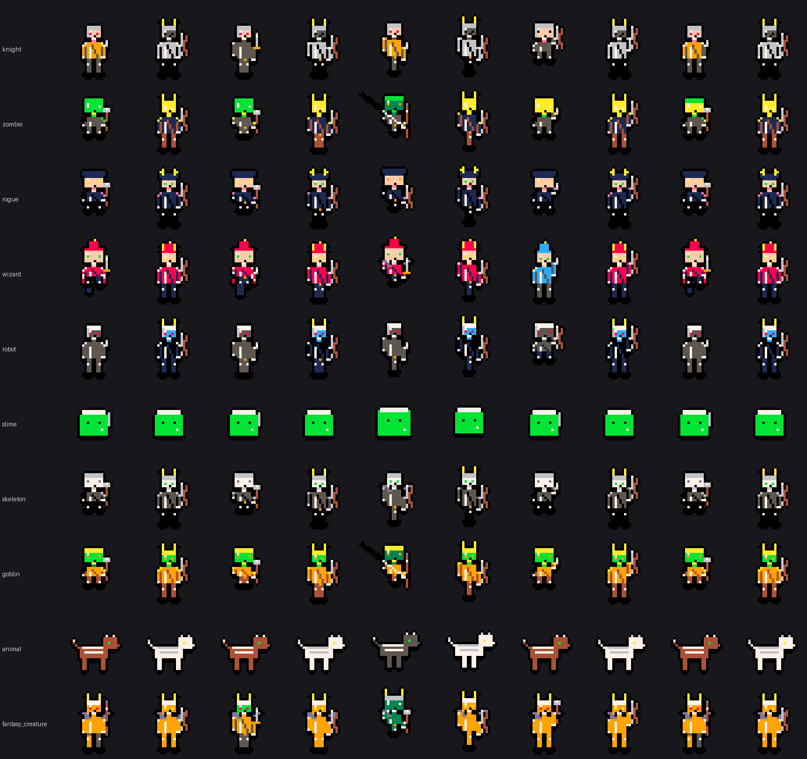
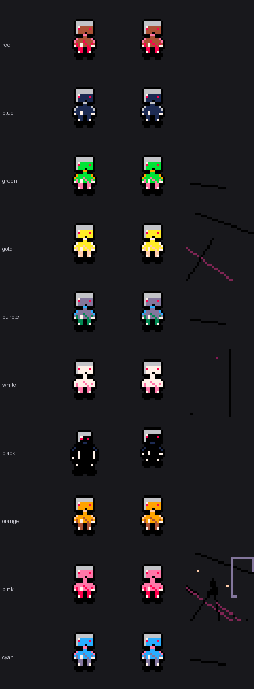
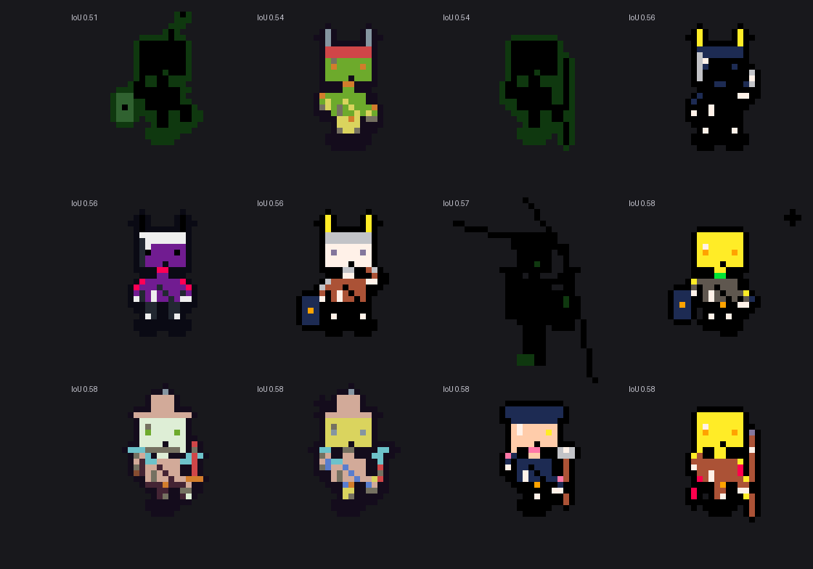

# Visual evaluation report

Generated from `svan_checkpoint_best.pt`, palette `pico8`, 32x32, nearest 4x.

## categories_poses.png

10 categories x 5 poses, left of each pair = neural, right = procedural

## colour_probe.png

rows = requested colour; columns = neural / procedural / untrained

## worst_cases.png

12 lowest-IoU neural generations with their prompts (see worst_cases.json)

