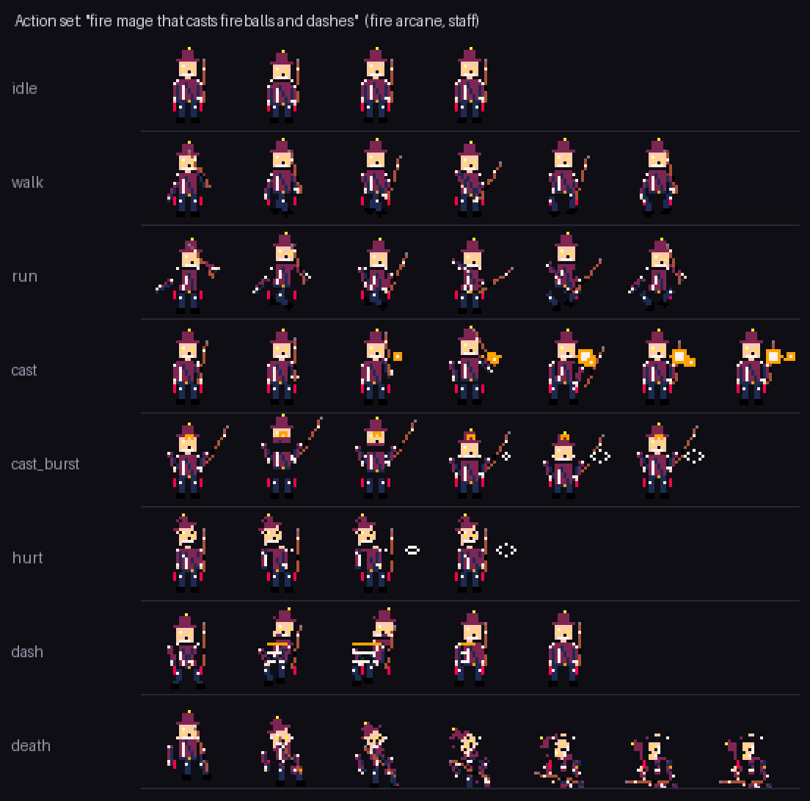
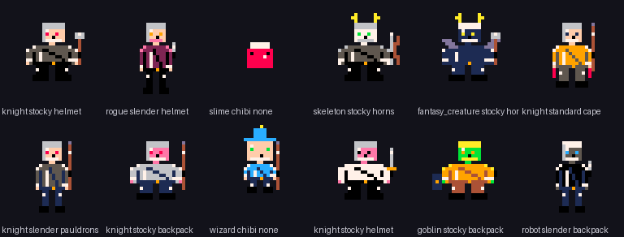
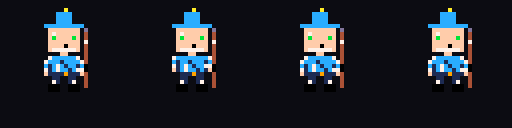

# Action Sets — prompt to playable animation package

One sentence in, a consistent set of animations out. SpriteMind reads the prompt, decides
*who* the character is, *which* animations a game of that kind expects, then synthesises every
animation from **one shared base character program** so identity (proportions, palette, gear)
never drifts between clips.



## How it works

```
prompt ──▶ ActionSetPlanner ──▶ ActionSpec[] ──▶ ActionSetBuilder ──▶ frames + GIFs + scripts
             (archetype,          (idle, walk,       (TemporalAnimator
              element, weapon,     cast, dash,        per clip + element FX
              action list)         death, …)          lines appended to PixelScript)
```

1. **Planner** (`spritemind.actions.planner`) maps words to an archetype (warrior / arcane /
   ranger / rogue / brute / critter), an element (fire, ice, lightning, holy, shadow, poison,
   arcane) and a weapon, then expands the archetype's signature list into concrete clips.
   Explicit mentions win: *"…who blocks and smashes"* adds `block` and `attack_heavy`.
2. **Builder** (`spritemind.actions.builder`) generates the idle pose once and reuses that
   PixelScript as the base for every other clip, so all clips share one character.
3. **Effects** (`spritemind.actions.effects`) append plain `PIXEL`/`LINE` actions to the frame
   script — projectiles, slash arcs, dash trails and auras are expressed in PixelScript, which
   means they stay editable, palette-correct and validator-checked like everything else.
4. **Temporal model** supplies motion for each clip; `cast` and `dash` got dedicated motion
   profiles (arm raise + follow-through, crouch → burst → settle) in
   `spritemind.dataset.temporal_dataset`.

## API

```bash
# Which animations does this prompt imply? (cheap, no rendering)
curl -s localhost:7861/api/action_set/plan -H 'Content-Type: application/json' \
  -d '{"prompt":"dark fantasy knight with a greatsword"}' | jq '.plan.actions[].key'

# Build the whole set
curl -s localhost:7861/api/action_set -H 'Content-Type: application/json' \
  -d '{"prompt":"fire mage that casts fireballs and dashes","seed":7}' \
  -o action_set.json
```

`POST /api/action_set` fields: `prompt`, `category`, `style`, `palette`, `width`, `height`,
`engine` (`procedural_baseline|trained_model|untrained_model`), `seed`, `actions` (force an
explicit clip list), `max_actions` (1–18), `include_gif`.

Every action in the response carries `key`, `label`, `frames` (each with `image_base64`,
`script_text`, `pixel_count`), `num_frames`, `fps`, `loop`, `effects` and `gif_base64`.

## In the UI

**Action Sets** tab: type a prompt → *Read prompt* shows the inferred archetype/element/weapon
and the planned clips → toggle clips off if you don't want them → *Generate Set* → each clip
plays inline with per-clip GIF download.

## Python

```python
from spritemind.actions import ActionSetBuilder, ActionSetPlanner

ActionSetPlanner.plan("cyberpunk ninja gunner").to_dict()
ActionSetBuilder.build(prompt="ice paladin with shield who blocks", seed=3, max_actions=5)
```

## Limits worth knowing

- Clips animate the *front-facing* sprite only; there is no left/right/back direction set yet.
- Element effects are stylised 1–3 px shapes chosen from the palette, not painted VFX sheets.
- Frame counts are fixed per clip type (4–7); the temporal model, not the planner, decides how
  the motion reads. Quality tracks the temporal checkpoint you select.

## Staying connected, staying varied

Two things made generated sets look broken, and both are now covered by tests in
`backend/tests/test_coherence.py` and `backend/tests/test_action_sets.py`.

**No floating parts.** Every emitted frame is checked for silhouette islands. If an
offset would tear a part off — an arm swung too far, a leg lifted out of the pelvis —
`spritemind.pixelscript.coherence` attenuates that frame's motion until the body is a
single connected shape again, and prefers offsets that keep the most visible pixels
so nothing appears to vanish between frames. Thin limbs (under 4 px) swing without
rotating, because a rotated 1 px limb breaks into a staircase and loses pixels.
Spell and slash effects are drawn after this check, so projectiles are allowed to
fly free of the body.

Rest poses are generated connected too: horns, wings, tails, bows and shields used to
be drawn as diagonal 1 px lines that only touched at the corners, or anchored to the
wrong arm, which is what "body part disconnect" looked like on a static sprite.

**No two characters alike.** The planner infers a body `proportion`
(standard/stocky/slender/chibi) and an `accessory` (helmet/cape/horns/wings/backpack/
pauldrons) from the prompt, and falls back to a seed-stable choice. The same prompt and
seed always rebuild the same character; a new seed — the dice button in the Action Sets
tab — gives a different build from the same prompt.




