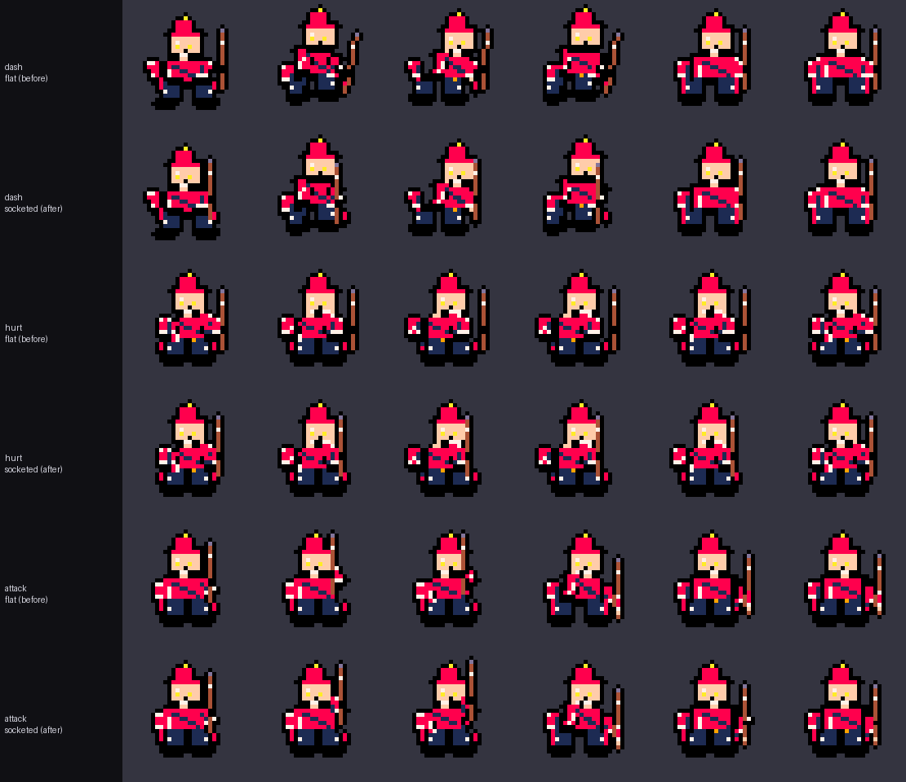
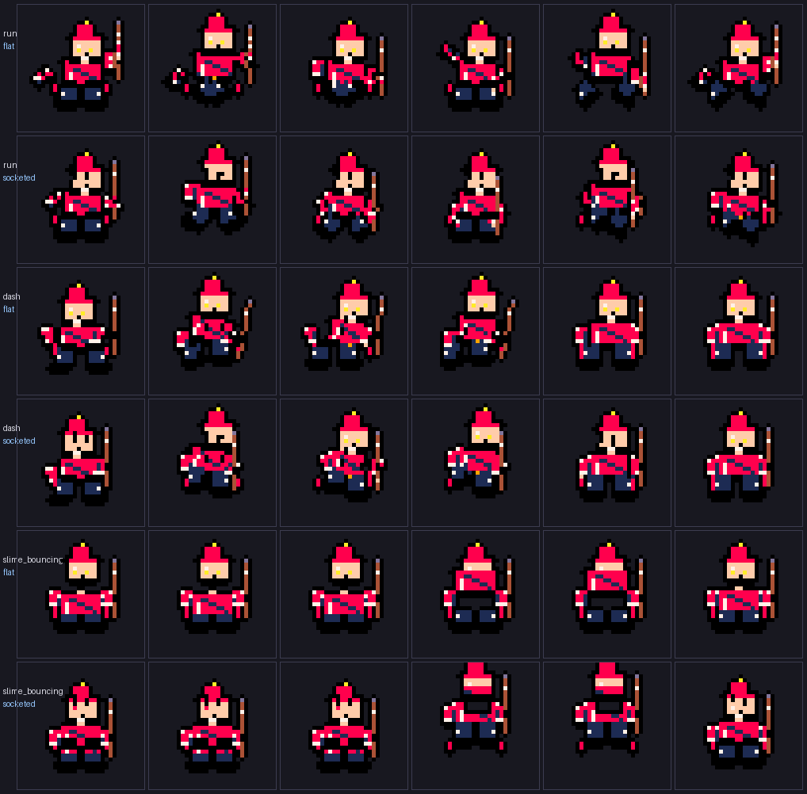

# Animation correctness and the attachment rig (Milestone A)

**Status: implemented on `lemon/milestone-a-animation-rig`, not merged.** No
retraining, no checkpoint, dataset or benchmark change. PixelScript grammar,
the renderer and the API surface are unchanged; the only new request parameter
(`rig_mode`) defaults to the new behaviour and `rig_mode="flat"` reproduces the
old frames exactly.

## 0. What was wrong

The six-frame wizard + staff + cape audit (`docs`-adjacent script
`scripts/audit_animation_rig.py`, seed 3, `pico8`, procedural baseline) found
three defects:

1. **Silent fallback.** `TemporalAnimator.generate_animation` replaced any
   animation name it did not recognise with `walk` and said nothing. `attack`
   and `hurt` — the two names the UI and the docs use — are not in
   `ANIMATION_CATEGORIES`, so both silently rendered a walk cycle. All 6 of 6
   `attack` frames and all 6 of 6 `hurt` frames were byte-identical to `walk`.
2. **Equipment detached from the body.** Weapon offsets were authored as
   absolute transforms in the frame script, independent of the limb holding
   them. As soon as the arm moved, the staff drifted: up to 4 px away from the
   hand during `hit_reaction`, 3 px during `dash`.
3. **No hierarchy at all.** `PART weapon arm_right …` declared a parent in the
   script, but nothing used it: children were positioned in canvas space, so a
   child could not follow a rotating or translating parent.

## 1. Animation name resolution

`spritemind/animations.py` holds the single source of truth:

* `SUPPORTED_ANIMATIONS` — derived from `ANIMATION_CATEGORIES`, so it cannot
  drift;
* `ANIMATION_ALIASES` — the names that already existed in prose, the UI copy and
  the action catalog: `attack`/`melee`/`slash`/`swing`/`strike` →
  `melee_attack`, `shoot`/`fire`/`bolt`/`throw` → `ranged_attack`,
  `hurt`/`damage`/`damaged`/`hit` → `hit_reaction`, `block`/`guard`/`shield` →
  `blocking`, `magic`/`spell`/`magic_attack`/`channel` → `cast`,
  `special`/`ability`/`ultimate` → `special_ability`, `stand`/`rest` → `idle`,
  `sprint` → `run`, `leap` → `jump`, `teleport` → `dash`, `die`/`dead` →
  `death`;
* `resolve_animation_name(name) -> (canonical, aliased)` — normalises case and
  separators, maps aliases, raises `UnknownAnimationError` for anything else.
  `None`/`""` still defaults to `walk`, because that is a historically
  documented default, not an error.

The generated animation now reports `requested_animation`,
`animation_category` (the resolved one) and `animation_aliased`, so a caller can
see what happened instead of guessing. Every animation name used by the frontend
dropdown and by `actions/catalog.py` is canonical, so no caller can hit the new
error path by accident.

## 2. Attachment rig

`spritemind/pixelscript/rig.py` composes parent-relative transforms **before**
the frame script is emitted, so the grammar, the renderer and any existing
absolute-offset script keep working untouched.

* `RigGeometry.from_script(script, w, h, palette)` renders the base pose once and
  records, per attachable part, a *grip* point and the matching *contact* point
  on its parent (closest pixel pair). The parent is taken from the sprite's own
  `PART <child> <parent> …` declaration when it has one; `ATTACHMENTS` only
  supplies the fallback parent and the rotation policy.
* `RigGeometry.resolve(offsets)` turns authored per-part offsets into socketed
  ones: `d_child = parent_point' − anchor_child − R(grip − anchor_child, rot_child)`.
  The child keeps its own rotation (unless `inherit_rotation` is set) and simply
  loses the drift.
* `rig_mode="flat"` bypasses the whole thing and reproduces the old absolute
  offsets. Tests pin that both modes differ, and that `flat` still shows the
  original drift.

### 2b. Joint constraint (body parts stay joined)

Socketing fixes the weapon, but the body itself could still come apart: the
motion tables author absolute per-part translations, so a swinging leg or a
bouncing slime could leave a 2–5 px transparent gap at the hip or shoulder —
the "missing pixels between transitions" that shows up as a disconnected limb.

`RigGeometry.resolve()` now runs a joint pass before socketing:

* each body part keeps the offset vector it was *drawn* with (`grip − socket`
  from the base pose), rotated by the parent's authored rotation;
* only drift beyond `JOINT_STRAY_SLACK` (0.25 px) is removed, so a limb can
  still swing a little on its own, and a rigid parent translation moves the
  child by exactly the same amount (`torso +4 px` → every part `+4 px`, not
  `+3 px` diagonally);
* the child's own rotation is never modified, so poses and swings survive.

Measured with the same audit (max gap between a part and its parent, wizard +
staff + cape, seed 3, 6 frames):

| animation | before (flat) | after (socketed + joints) |
|---|---|---|
| run | 4.0 px (`arm_left`→torso) | **1.0 px** |
| attack / melee_attack | 2.0 px (`arm_left`) | **1.0 px** |
| cast | 2.0 px (`leg_left`) | **1.0 px** |
| special_ability | 3.0 px (`leg_left`) | **1.0 px** |
| slime_bouncing | 5.0 px (`leg_left`) | **1.0 px** |
| hurt / hit_reaction | 4.0 px (`weapon`→arm) | **1.0 px** |
| dash | 3.0 px (`weapon`→arm) | **1.0 px** |
| idle / walk | 1.0 px | 1.0 px |

1.0 px is adjacency: the parts touch but do not overlap. Every animation in the
audit now reports `max_joint_gap = 1.0`.

### Why weapon rotation is *not* inherited

`ATTACHMENTS["weapon"]["inherit_rotation"]` defaults to `False`, deliberately.
The motion tables already author the weapon swing on top of the arm swing; at
the melee peak the authored weapon rotation is 55° and the arm adds 40°, so
inheriting rotation gives 95° — the staff swings past horizontal and stops
reading as a strike. Measured overlap with the head is also lower with
position-only socketing. The flag exists so a future motion table that defines
weapon rotation as *relative* can switch it on.

## 3. Measurements

`scripts/audit_animation_rig.py` reproduces both columns. Wizard, `pico8`,
staff + cape, seed 3, 6 frames, `engine_mode="procedural_baseline"`:

Weapon-to-hand distance (px between the nearest weapon pixel and the nearest
pixel of `arm_right`):

| animation | before: max / mean | after: max / mean |
|---|---|---|
| idle | 1.0 / 1.0 | **0.0 / 0.0** |
| walk | 1.0 / 0.667 | 1.0 / **0.167** |
| run | 1.0 / 0.833 | 1.0 / **0.333** |
| attack | 1.0 / 0.667 *(rendered as walk)* | 1.0 / **0.167** *(melee_attack)* |
| hurt | 1.0 / 0.667 *(rendered as walk)* | **0.0 / 0.0** *(hit_reaction)* |
| cast | 1.0 / 0.5 | 1.0 / 0.5 |
| dash | 3.0 / 1.833 | **0.0 / 0.0** |
| melee_attack | 1.0 / 0.333 | 1.0 / 0.167 |
| hit_reaction | 4.0 / 2.667 | **0.0 / 0.0** |
| special_ability | 1.0 / 1.0 | **0.0 / 0.0** |
| slime_bouncing | 1.0 / 1.0 | **0.0 / 0.0** |

A remaining `max` of 1.0 is one pixel of adjacency: the staff is *held*, so its
pixels touch the hand rather than coincide with it. `dash` and `hit_reaction`
are the two animations whose arms move furthest; they are now fully attached
(0.0 px), which is exactly where the drift was worst before.

Frame-identity against `walk`: before the fix `attack` 6/6 and `hurt` 6/6 were
identical to `walk`; after, every animation is 0/6. Silhouette stays a single
connected component in every frame of every animation (islands = 1), so the
sockets do not fragment the sprite. Weapon overlap with `head`/`torso` fell to
0.00 on average for `melee_attack` (it was 0.08 head / 0.09 torso with flat
offsets) — the staff no longer passes through the wizard's head.

## 4. Compatibility

| surface | impact |
|---|---|
| PixelScript grammar / renderer | none — sockets are resolved before emission |
| existing scripts with absolute `TRANSFORM` | unchanged when `rig_mode="flat"`; identical semantics otherwise, only attachable parts are recomposed |
| `generate_animation(...)` callers | new optional kwarg `rig_mode`, defaults `"socketed"`; new output keys |
| API `/api/animation/generate` | unchanged shape; new keys are additive |
| frontend | unchanged; every name in the dropdown was already canonical |
| checkpoints / datasets / benchmarks | untouched |

## 5. Tests

*Body-part contact for `run`, `dash` and `slime_bouncing`: `flat` transforms on
top (limbs detached by 3–5 px), socketed rig + joint constraint below.*

*Six frames of `dash`, `hurt` and `attack` for the same wizard + staff + cape,
rendered with `rig_mode="flat"` (before) and `rig_mode="socketed"` (after).*

`backend/tests/test_animation_rig.py` (62 cases): canonical vs aliased vs
unknown names, case/separator normalisation, the historical empty-name default,
alias reporting in output, rejection of unsupported names, `attack`/`hurt` no
longer byte-identical to `walk`, weapon-arm motion differing between walk and
melee, `mask_min_distance` / `weapon_hand_distance` unit behaviour, weapon within
1 px of the hand for idle/walk/run/attack/hurt/cast/dash, `flat` mode still
showing the old drift (regression guard), single-island silhouettes, rig
determinism, a drifting limb being pulled back, a rigid translation being
preserved exactly, rotations surviving the joint pass, rendered limbs staying
within 1 px of their parent across eight animations, cape
following the torso without spinning, a geometry with no attachable parts being
a no-op, and the API resolving aliases / returning 400 for an unknown name.

Attachment is verified numerically and by the rendered sheet above. Subjective
motion quality (does the swing *read* well?) was not judged by a human in this
milestone — the numbers show the staff stays in the hand, not that the animation
is beautiful.

Full backend suite: 399 passed. `ruff check` clean. Frontend `tsc --noEmit` and
`npm run build` clean.

## 6. What this does not fix

The rig corrects *attachment*, not *motion quality*. The walk cycle still has no
knee/elbow articulation beyond the authored two-segment swings, and `cast` is
unchanged (its hand barely moves, so there was nothing to correct). Interpolated
in-betweens and two-bone IK remain future work in
`docs/SPRITEMIND_IMPROVEMENT_ROADMAP.md`.
